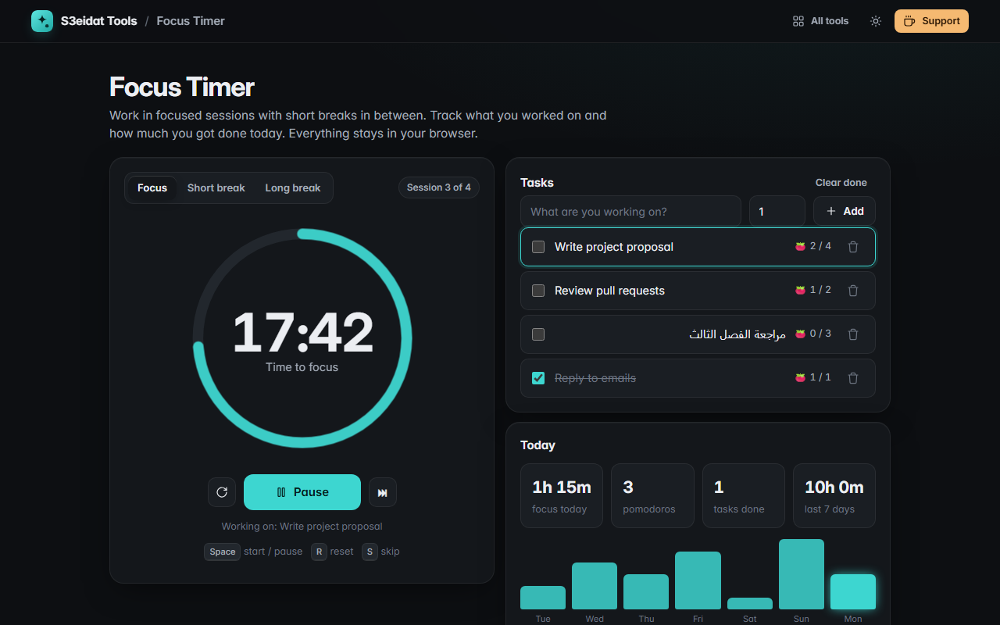

# Focus Timer

> A Pomodoro timer with tasks, gentle chimes and daily stats. Free, private, and it runs entirely in your browser.

### ▶ [Open Focus Timer](https://s3eidat.github.io/focus-timer/)



## Features

- **Focus, short break and long break** sessions with your own durations; a long break every N sessions
- **Accurate timing**: the countdown is computed from the clock, so it stays right in background tabs and survives a page reload
- **Auto-start** breaks and/or focus sessions (optional)
- Gentle **chime** made with WebAudio (volume control, test button)
- Remaining time shown in the **tab title**
- Optional **notifications** when a session ends in a background tab (asked only when you click the button)
- **Task list**: estimated vs completed pomodoros per task, pick the current task, tick tasks done
- **Daily stats**: focus time, pomodoros and tasks done today, plus a 7-day chart
- Keyboard: <kbd>Space</kbd> start/pause, <kbd>R</kbd> reset, <kbd>S</kbd> skip

## Privacy

Tasks, settings and stats are saved only in your browser (localStorage). There is no server, no account, no analytics.
The page ships with a strict Content-Security-Policy (`connect-src 'self'`), so the browser
itself blocks any attempt to send data anywhere.

## Run it yourself

It's plain HTML, CSS and JavaScript with no build step:

```bash
git clone https://github.com/s3eidat/focus-timer
cd focus-timer
python -m http.server 8000
```

Then open http://localhost:8000.

## Support

If this saved you time, **[buy me a coffee ☕](https://s3eidat.github.io/coffee/)**. It keeps every tool free.

---

Part of **[S3eidat Tools](https://s3eidat.github.io/)**: 100+ free, private tools that run in your browser. MIT licensed.
